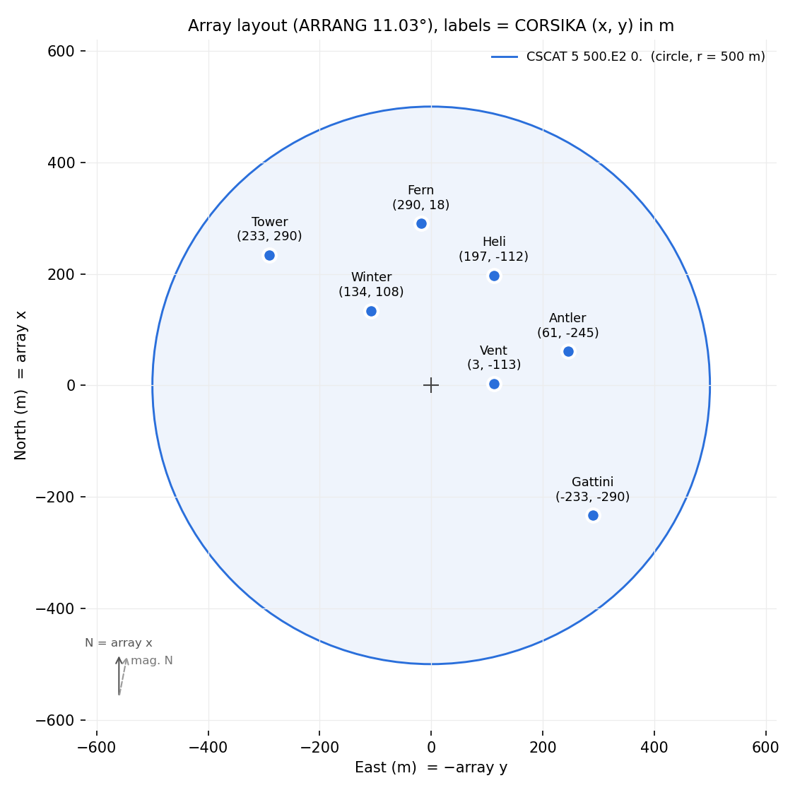

# simulation_tools

CORSIKA -> sim_telarray simulations of the PANOSETI array, using the [PANOSETI sim_telarray config](https://github.com/orelgueta/PANOSETI_sim_telarray_config). `run_simulation.py` runs a production as SLURM job arrays (one task per CORSIKA run), or one run at a time locally. Everything is set in one YAML config, see [`configs/simulation.yaml`](../configs/simulation.yaml).

* `run_simulation.py` - the pipeline
* `corsika_template.inp` - the CORSIKA input card every run's card is made from

## Requirements
* [CORSIKA 7](https://www.iap.kit.edu/corsika/index.php), verified for 78010, compiled with IACT, CHERENKOV, VOLUMEDET, VIEWCONE, SLANT, ATMEXT, QGSJET-III and UrQMD
* [sim_telarray](https://www.mpi-hd.mpg.de/hfm/~bernlohr/sim_telarray/), verified for release 2025.51.0
* [PANOSETI_sim_telarray_config](https://github.com/orelgueta/PANOSETI_sim_telarray_config)
* `zstd` on the `PATH`: CORSIKA and sim_telarray write their `.zst` files through it
* Python with `numpy` and `pyyaml` (installing `heap` brings both)

## Quick start
Copy the config and set the paths to your CORSIKA, sim_telarray and PANOSETI config installs:
```
cp configs/simulation.yaml my_simulation.yaml
```
Try one run locally first; for a quick test, set e.g. `corsika: {NSHOW: 2}` in the config (2 showers in the run; `--run 1` is the run number, not a shower count):
```
python simulation_tools/run_simulation.py run --config my_simulation.yaml --run 1
```
Add `--verbose` to also print CORSIKA's and sim_telarray's output (otherwise only in their logs in `<output_dir>/logs/`).
Then submit the production to SLURM. `--dry-run` writes the sbatch script without submitting it, so you can check it:
```
python simulation_tools/run_simulation.py submit --config my_simulation.yaml --dry-run
python simulation_tools/run_simulation.py submit --config my_simulation.yaml
```

## Stages
`run_simulation.py` has four commands, given as its first argument: `prepare`, `submit`, `run` and `simtel` (see Commands). `submit` sends a whole production to SLURM; `run` and `simtel` each do one task locally.

A stage is the part of the CORSIKA -> sim_telarray chain that `submit` sends to SLURM, chosen with `submit --stage`:

| stage | each array task runs | one array task per | same task run locally, one at a time |
|---|---|---|---|
| `full` (default) | CORSIKA, then sim_telarray | run number, `first_run` ... `first_run + n_runs - 1` | `run_simulation.py run --run N` |
| `simtel` | sim_telarray only, on a CORSIKA file that already exists | file matching `paths.corsika_input` | `run_simulation.py simtel --file PATH` |

Each SLURM array task itself calls `run_simulation.py run` or `run_simulation.py simtel`.

A CORSIKA run number only labels a run (and seeds it); it is not a number of showers. Each run simulates `NSHOW` showers (set in the template or the config's `corsika` section), so a production has `n_runs` runs and `n_runs x NSHOW` showers. Each shower is reused `CSCAT`'s first value times at random core positions, giving `n_runs x NSHOW x CSCAT` events. E.g. `first_run: 1`, `n_runs: 10`, `NSHOW: 10`, `CSCAT 5 ...` gives runs 1 ... 10, 100 showers and 500 events.

## Commands
Every command takes `--config` with the path to your simulation YAML, e.g.
```
python simulation_tools/run_simulation.py <command> --config my_simulation.yaml [flags]
```

### `prepare`
Checks the config's paths and writes every run's CORSIKA card to `<output_dir>/inputs/`. No other flags.

### `submit`
Writes a SLURM array script for a stage and submits it (the `full` stage runs `prepare` first).

| flag | |
|---|---|
| `--stage full` or `--stage simtel` | which stage to submit, see Stages (default `full`) |
| `--dry-run` | write the sbatch script but don't submit it |
| `--verbose` | passed on to the jobs, so their SLURM logs include CORSIKA's and sim_telarray's output |

### `run`
The full stage for one CORSIKA run: CORSIKA, then sim_telarray. Give exactly one of `--run` or `--index`:

| flag | |
|---|---|
| `--run N` | CORSIKA run number `N`, e.g. `--run 1` |
| `--index I` | run number `first_run + I` (what the SLURM array tasks call) |
| `--overwrite` | redo outputs that already exist |
| `--verbose` | also print CORSIKA's and sim_telarray's output |

### `simtel`
sim_telarray only, on one existing CORSIKA IACT file. Outputs are named after the file, minus `.corsika.zst`. Give exactly one of `--file` or `--index`:

| flag | |
|---|---|
| `--file PATH` | the CORSIKA file, e.g. `--file sim_output/gamma_10TeV/corsika/gamma_10TeV_run000001.corsika.zst` |
| `--index I` | the I-th file (from 0) matching `paths.corsika_input`, sorted (what the SLURM array tasks call) |
| `--overwrite` | redo outputs that already exist |
| `--verbose` | also print sim_telarray's output |

`run` and `simtel` skip outputs that already exist, unless given `--overwrite`. They print timestamped progress: the run's card and work directory, a line per finished CORSIKA shower, how long each step took, sim_telarray's summary (triggered telescopes, events processed) and the output paths. `--verbose` also echoes the CORSIKA and sim_telarray commands and their full output, which otherwise only go to their logs (with `mode: pipe` sim_telarray's output only goes to its log either way).

## Data levels (mode)
The `full` stage produces two data levels: CORSIKA's air-shower output (Cherenkov photons at the telescopes) and sim_telarray's telescope events. `production.mode` sets which of them are kept:
* `files` - both. CORSIKA writes `<output_dir>/corsika/<name>_run<NNNNNN>.corsika.zst`, then sim_telarray runs on it. The kept CORSIKA files let you rerun sim_telarray later without rerunning CORSIKA.
* `pipe` - sim_telarray events only. CORSIKA streams its output straight into sim_telarray (`TELFIL |./simtel_pipe.sh`; the script holds the sim_telarray command, since CORSIKA doesn't allow shell syntax in `TELFIL`). This saves disk space, but any sim_telarray change means rerunning CORSIKA.

## Rerunning sim_telarray
The `simtel` stage reruns sim_telarray only, e.g. after a change to the PANOSETI config or to the `sim_telarray` section. Copy your config and give the copy a new `tag` in its `sim_telarray` section, so the new outputs go to `simtel/<tag>/` next to the earlier ones instead of being skipped as already done. The tag can be any name, e.g. one describing the change:
```yaml
sim_telarray:
  tag: threshold_5.5     # was v1
```
```
python simulation_tools/run_simulation.py submit --config my_simulation_v2.yaml --stage simtel
```
It runs on `paths.corsika_input`, a glob: by default this production's own CORSIKA files, but it can point at any CORSIKA IACT files.

## Config
Paths are resolved relative to the project root if not absolute; `~` and `$VARS` are expanded.

### paths
| key | |
|---|---|
| `corsika_run_dir` | CORSIKA's `run/` directory: the binary and the data tables it reads at runtime |
| `corsika_binary` | CORSIKA binary name, inside `corsika_run_dir` |
| `sim_telarray_dir` | sim_telarray install, the directory holding `bin/sim_telarray` |
| `sim_telarray_config` | the PANOSETI `.cfg`; its directory goes on sim_telarray's include path, so the `.dat` files next to it are found |
| `corsika_template` | CORSIKA card template, see below |
| `output_dir` | where everything is written, see Outputs |
| `corsika_input` | CORSIKA files for the `simtel` stage, as a glob (`null` = `<output_dir>/corsika/*.corsika.zst`) |
| `work_dir` | scratch space for each run while it runs (`null` = `$TMPDIR` if set, usually node-local on SLURM, otherwise `<output_dir>/work`). Each run's directory in it is deleted when the run succeeds, and the work directory too once it's empty (except `$TMPDIR`) |

### production
| key | |
|---|---|
| `name` | prefix of every file name, `<name>_run<NNNNNN>` (letters, digits and `_.+-` only) |
| `mode` | which data levels are kept: `files` (CORSIKA and sim_telarray) or `pipe` (sim_telarray only), see Data levels |
| `first_run`, `n_runs` | number of runs, `n_runs`, and the CORSIKA run numbers they get, `first_run` ... `first_run + n_runs - 1` (at most 999999). Showers per run are `NSHOW` in the `corsika` section, see Stages |
| `seed` | base seed; each run's CORSIKA and sim_telarray seeds are derived from it and the run number, so a production can be regenerated exactly |

### corsika
keyword overrides applied to the template, e.g.
```yaml
corsika:
  NSHOW: 100
  ERANGE: [1E3, 1E5]
  PRMPAR: 14
  TELESCOPE:            # replaces every TELESCOPE line; rows are x y z r in cm
    - [0., 0., 0., 25]
    - [100.E2, 0., 0., 25]
```
Lists are joined with spaces; keywords missing from the template are added before `EXIT`. `RUNNR`, `SEED`, `TELFIL` and `DIRECT` are set by the pipeline and can't be overridden.

### sim_telarray
| key | |
|---|---|
| `telescope_theta`, `telescope_phi` | telescope pointing [deg], in sim_telarray's convention (zenith angle; azimuth from north, clockwise). Check the `Array viewing direction` line in the sim_telarray log |
| `tag` | output subdirectory under `simtel/` and `logs/` |
| `defines` | preprocessor macros (`-D`), e.g. `PANOSETI_TRIGGER_PIXELS: 1` |
| `parameters` | config parameter overrides (`-C`), e.g. `discriminator_threshold: 5.5`; lists are joined with commas |

### slurm
| key | |
|---|---|
| `partition`, `account` | `#SBATCH --partition` / `--account` (`null` = left out) |
| `time`, `mem` | per array task, e.g. `"04:00:00"` and `4G` |
| `max_concurrent` | maximum array tasks running at once (`null` = no limit) |
| `mail_user`, `mail_type` | email for SLURM notifications (`null` = none) and the events to send, e.g. `END,FAIL` (once for the whole array) or `END,FAIL,ARRAY_TASKS` (once per task) |
| `python` | the Python that runs `run_simulation.py` on the nodes (`null` = the one running `submit`) |
| `extra_options` | more `#SBATCH` options, e.g. `["--qos=normal"]` |
| `setup` | shell lines run before the pipeline in each job, e.g. `module load ...` or activating a conda environment |

## CORSIKA template
`corsika_template.inp` is a complete CORSIKA card: the 7-telescope layout at `OBSLEV 1650.E2`, 10 gammas per run (`NSHOW 10`) from a 3-100 TeV power law with index -2.7 (`ERANGE 3E3 1E5`, `ESLOPE -2.7`), each used 5 times (`CSCAT 5 500.E2 0.`), and primary directions from a viewing cone around 20 deg zenith angle (`THETAP 20. 20.`, `PHIP 0. 0.`, `VIEWCONE 0. 0.`). Edit it for changes every production shares, and use the config's `corsika` section for per-production ones. For each run the pipeline sets `RUNNR`, the `SEED` lines (as many as the template has) and `TELFIL`; `<output_dir>/inputs/` holds each run's final card.

### Array layout


The template's `TELESCOPE` lines (`x y z r` in cm) place the 7 telescopes in CORSIKA's array frame, x north and y west, with `ARRANG` the angle from magnetic north to that x axis. The plot shows them on the ground, east right and north up; labels are each telescope's (x, y) in m. The shaded circle is where `CSCAT 5 500.E2 0.` throws shower cores: uniformly within 500 m of the array origin (+) (a `0.` second value makes the area a circle of the first value's radius).

`VIEWCONE inner outer` draws each primary's direction uniformly in solid angle between `inner` and `outer` degrees of the cone's axis (`THETAP`/`PHIP`, which must then have equal low and high values). Point the telescopes along the axis (`sim_telarray.telescope_theta`/`telescope_phi`), so the cone angles are off-axis angles. Set it per production in the config's `corsika` section:

| sample | `VIEWCONE` |
|---|---|
| point-source gammas, at the 0.5 deg wobble offset (a ring at random azimuth) | `[0.5, 0.5]` |
| on-axis gammas | `[0., 0.]` (the template's default) |
| diffuse gammas, protons | `[0., 10.]` |

The 10 deg diffuse cone covers the ~10 deg field of view (corners ~7 deg off-axis) with a few degrees' margin for showers from outside it whose images still reach the camera.

Keep `OBSLEV` matched to the PANOSETI config's `altitude` and its atmospheric transmission table (`atm_trans_1650_...` for 1650 m): sim_telarray refuses a table for another altitude, or gives zero transmission below the table's lowest altitude.

## Outputs
```
<output_dir>/inputs/<name>_run<NNNNNN>.inp                 CORSIKA cards
<output_dir>/corsika/<name>_run<NNNNNN>.corsika.zst        CORSIKA IACT files (`mode: files` only)
<output_dir>/simtel/<tag>/<name>_run<NNNNNN>.simtel.zst    sim_telarray events
<output_dir>/simtel/<tag>/<name>_run<NNNNNN>.hdata.zst     sim_telarray histograms
<output_dir>/logs/<name>_run<NNNNNN>.corsika.log
<output_dir>/logs/<tag>/<name>_run<NNNNNN>.simtel.log
<output_dir>/slurm/<job>.sbatch                            submitted script
<output_dir>/slurm/<job>.yaml                              config copy that submission's jobs read
<output_dir>/slurm/<job>.files                             simtel stage: its input files, one per array task
<output_dir>/slurm/logs/<job>_<SLURM job id>_<task>.out    job stdout/stderr
```
with `<job>` = `<stage>_<tag>_<YYYYmmdd-HHMMSS>`. Because each submission's jobs read their own config copy, editing the config or submitting again doesn't change jobs already queued.

## Failures and reruns
Each run works in its own scratch directory and moves its outputs to `output_dir` only when CORSIKA reports `END OF RUN` and sim_telarray reports it finished. A failed run raises an error naming its log and keeps its scratch directory for debugging. Runs whose outputs exist are skipped, so submitting the same config again reruns only the failed ones.

## Notes
* sim_telarray reads only the first 4 telescopes of a CORSIKA file unless told otherwise; the pipeline sets `maximum_telescopes` from the file's header (with `mode: pipe`: from the card's `TELESCOPE` lines).
* Many clusters cap SLURM job arrays at about 1000 tasks (`MaxArraySize`). Split bigger productions into several configs with different `first_run`.
